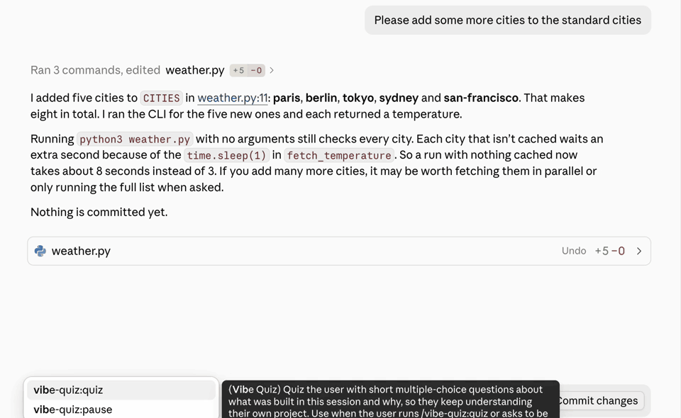

# Vibe Quiz

A Claude Code plugin that keeps you from getting lost in your own projects while vibe coding.

With auto mode on, it's easy to skim Claude's replies and keep going. The project moves forward,
but your understanding doesn't. Every now and then, Vibe Quiz pops up a few short
multiple-choice questions about what was just built in your session and, more importantly,
*why*. Answering takes about 30 seconds, and a wrong answer gets a one-line explanation that
points to the file, commit or decision it came from.

## Demo Video



## Install

In Claude Code (v2.1.275 or later):

```
/plugin install vibe-quiz --marketplace JasperMeijerink/vibe-quiz
```

Or from your shell:

```bash
claude plugin marketplace add JasperMeijerink/vibe-quiz
claude plugin install vibe-quiz@vibe-quiz
```

Already in a session? Run `/reload-plugins` to load it there without restarting.

The first time a quiz starts on its own, Claude Code asks permission to run the
`vibe-quiz:quiz` skill. Pick "always allow" so it doesn't ask again.

## Commands

| Command | What it does |
|---|---|
| `/vibe-quiz:quiz` | Quiz now about this session's work |
| `/vibe-quiz:quiz <topic>` | Quiz on one part of the work, e.g. `/vibe-quiz:quiz data loading` |
| `/vibe-quiz:quiz --depth <level>` | Pick the depth: `recall`, `understand`, `apply` or `challenge` |
| `/vibe-quiz:pause` | No automatic quizzes for the rest of this session |
| `/vibe-quiz:pause <n>` | Skip the next n automatic quizzes |
| `/vibe-quiz:pause off` | Turn automatic quizzes back on |

To skip a single quiz, press Esc, or pick "Other" and type "skip".

## Examples

1. **Just keep working.** After every 8 of Claude's replies, a quiz with 3 questions pops up
   about what was just built, such as "Why is the cache invalidated on write instead of on a
   timer?". You click an answer for each, and a wrong answer gets a one-line explanation.
2. **Check yourself after a big change.** Finished a refactor? Run `/vibe-quiz:quiz` to be
   quizzed on the whole session so far.
3. **Focus on one part, harder.** `/vibe-quiz:quiz auth --depth apply` asks only about the auth
   work, with questions like "If two users log in at once, what happens with the current token
   refresh?".
4. **Ask in your own words.** "Quiz me on the caching change we just made" works too.
5. **Quiz per commit instead of per reply.** In `/config`, set `trigger` to `commits` and
   `interval` to 3 to get a quiz after every third commit.
6. **Need a quiet stretch?** Run `/vibe-quiz:pause 2` before a demo to skip the next two
   automatic quizzes, or `/vibe-quiz:pause` for the rest of the session.

## Settings

Change these in `/config` under Vibe Quiz:

| Setting | Default | Options |
|---|---|---|
| `trigger` | `turns` | `turns` (every N Claude replies), `commits` (every N git commits) or `manual` |
| `interval` | `8` | The N, from 1 to 50 |
| `questions_per_quiz` | `3` | 1 to 4 |
| `depth` | `understand` | `recall`, `understand`, `apply` or `challenge` |
| `focus` | `both` | `decisions`, `implementation` or `both` |

## What it runs and stores

- **Hooks.** When Claude finishes a reply (`Stop`) or makes a git commit (`PostToolUse`), a
  small bundled shell script, `scripts/auto-quiz.sh`, updates a counter and decides whether a quiz
  is due. When one is due, it asks Claude to run the quiz skill.
- **Quiz skill.** Claude writes the questions from what's already in the current session's
  context, plus read-only git commands (`git status`, `git log`, `git diff`, `git show`) and
  reads of files in your project. It doesn't look at past chats or memory.
- **Stored data.** One small file per session (about 30 bytes) in the plugin's data folder
  (`~/.claude/plugins/data/…/sessions/`), holding the reply count, the commit count and the pause
  state. Your answers, scores and code are never stored. A session's file is deleted after 7 days
  without activity (checked after every finished reply), and the whole folder is removed when you
  uninstall the plugin.
- **No network access.** Nothing is sent anywhere by the plugin itself.

See [PRIVACY.md](PRIVACY.md) for the full privacy policy.

Automatic quizzes only start at the end of one of Claude's replies, never inside subagents. They
wait a little if Claude just asked you something or work is still running, and they stay silent
in non-interactive runs such as `claude -p` and CI.

## Requirements

Claude Code 2.1.275 or later, on macOS, Linux or Windows. The hook script uses POSIX `sh`, `sed`,
`grep` and `find`.

- **Windows:** needs [Git for Windows](https://git-scm.com/downloads/win) (Git Bash), which Claude
  Code uses to run hooks. WSL also works. With PowerShell only, automatic quizzes don't run, but
  `/vibe-quiz:quiz` still works. Native Windows support hasn't been tested on a real Windows
  machine yet (only in CI). If something doesn't work, please
  [open an issue](https://github.com/JasperMeijerink/vibe-quiz/issues).

In claude.ai chat, hooks don't run, so only manual quizzes work there.

## Troubleshooting

- **No quiz pops up on its own.**
  - Check in `/config` that `trigger` isn't `manual`, and what `interval` is set to.
  - Run `/vibe-quiz:pause off` in case quizzes are paused.
  - A due quiz also waits while Claude's last reply asks you something or background work is
    running, for at most twice the interval.
- **The plugin doesn't seem to be loaded.** Run `/reload-plugins`, or start a new session. Then
  check `/plugin` for errors.
- **Claude Code asks permission every time.** Choose "always allow", or add
  `Skill(vibe-quiz:quiz *)` to `permissions.allow` in your settings.
- **Quizzes come too often.**
  - Raise `interval` in `/config`, or switch `trigger` to `commits`.
  - Or pause with `/vibe-quiz:pause`.
- **The questions are about older work.** There wasn't enough new work in the session yet. A
  manual quiz then falls back to your recent commits and says so in its first line.
- **Plain-text questions instead of a pop-up.** The clickable prompt isn't available there. Reply
  like `1B 2D 3A`.
- **Nothing happens in `claude -p` or CI.** That's by design: automatic quizzes stay silent when
  nobody can answer.
- **A hook error after every reply on Windows.** Claude Code runs hooks through Git Bash, and
  falls back to PowerShell when Git for Windows isn't installed. The hook script needs `sh`,
  so install [Git for Windows](https://git-scm.com/downloads/win) and restart Claude Code, or use
  WSL.

## Uninstall

```bash
claude plugin uninstall vibe-quiz@vibe-quiz
```

## Feedback

Found a bug, or a quiz question that missed the mark? Open an issue at
[github.com/JasperMeijerink/vibe-quiz/issues](https://github.com/JasperMeijerink/vibe-quiz/issues).
Want to change the code yourself? See [CONTRIBUTING.md](CONTRIBUTING.md).

## License

MIT, see [LICENSE](LICENSE).
